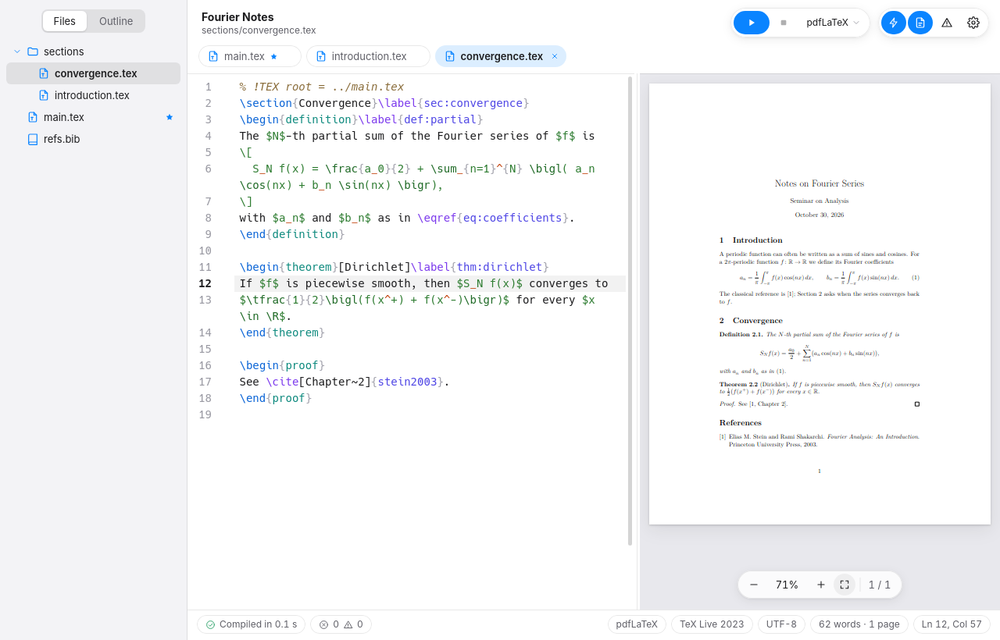
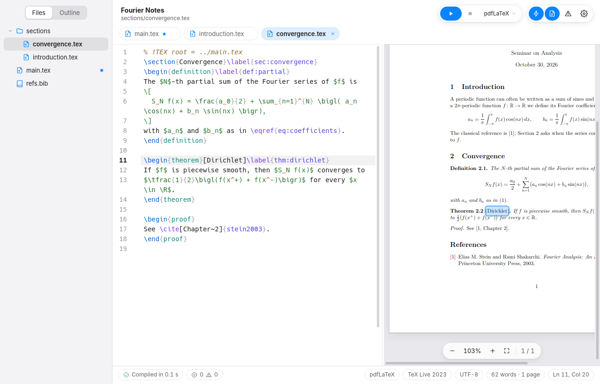
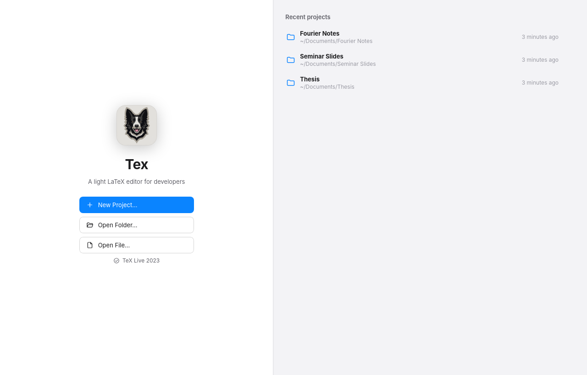

<p align="center">
  
</p>

<h1 align="center">Tex</h1>

<p align="center">
  <b>A light LaTeX editor for developers.</b><br>
  The PDF follows your unsaved text as you type, a click takes you from the PDF to the exact word in the source and back,
  and every error is underlined on the line that caused it.
</p>

<p align="center">
  <a href="https://github.com/toniesteves/tex/releases/latest"></a>
  <a href="LICENSE"></a>
  
</p>

<p align="center">
  <a href="https://github.com/toniesteves/tex/releases/latest"></a>
</p>

<p align="center">
  <a href="https://github.com/toniesteves/tex/releases">Releases</a> ·
  <a href="https://github.com/toniesteves/tex/issues">Issues</a> ·
  <a href="LICENSE">License</a> ·
  <a href="README.pt-BR.md">Português (Brasil)</a>
</p>

<p align="center">
  
</p>

---

## Platforms

| Platform | Status | Technology | Download |
|---|---|---|---|
| **Linux** | Available (0.1.2), tested on Linux Mint 22 | Tauri 2 (Rust + TypeScript), the system's WebKitGTK | [`.deb` package](https://github.com/toniesteves/tex/releases/latest) |

## Why Tex

Most LaTeX documents are a folder: a `main.tex`, one file per chapter or section, figures and a `.bib`. Tex is built
for that folder, and it tries to stay out of the way:

1. **Light.** A 2.7 MB package that uses the web view your system already has. No bundled browser, no Electron.
2. **Your folder stays clean.** TeX runs in a private cache, so no `.aux`, `.log` or `.synctex.gz` ends up next to your
   sources, and the text you have not saved yet is compiled without writing it to disk.
3. **Fast feedback.** About a second after you stop typing, the PDF shows the change and the errors are underlined in
   the editor, on the right line of the right file.

## Main features

- **Folders and navigation:** open any folder (or a `.tex`, which opens its folder) or start from a template: Article,
  Thesis, Presentation (Beamer), Math Notes, Problem Set or Blank. File tree with a context menu, tabs, Quick Open
  (Ctrl+P) and a document outline that spans every included file, labels included.
- **Live compilation:** `latexmk` with pdfLaTeX, XeLaTeX or LuaLaTeX, chosen by a `% !TEX program` comment, the
  project or the default. The main file comes from `% !TEX root`, your choice or automatic detection. Saving (Ctrl+S)
  or compiling (Ctrl+B) writes the PDF next to the main file.
- **Errors and warnings in place:** TeX and BibTeX messages underlined at the right line, plus live warnings for
  undefined references, duplicate labels and citations missing from the bibliography. An Issues panel with filters and
  the full log.
- **Two-way SyncTeX, down to the word:** double-click a word in the PDF to land on it in the source; Ctrl+click in the
  source (or Ctrl+Shift+J) to highlight that word in the PDF. The PDF reloads without flashing and keeps its position.
- **Autocomplete:** commands, environments (`\begin{` writes the `\end`), `\end{` with the open environment first,
  labels in `\ref`, keys in `\cite`, files in `\input` and `\includegraphics`, packages, classes, and the commands and
  environments your own project defines. Inside math, math commands come first.
- **Beamer presentations (F5):** the audience view full screen on one display and a presenter view with the next slide,
  Beamer notes, a timer and the clock on the other. With a single display, P shows the presenter view on top.
- **Writing tools:** Command Palette (Ctrl+Shift+P), editable shortcuts, optional Vim mode, word and page counts, light
  and dark themes, and an interface in English and Brazilian Portuguese (both follow the system).

<p align="center">
  
</p>

<p align="center">
  
</p>

## Get Tex

Download the `.deb` from the [latest release](https://github.com/toniesteves/tex/releases/latest) and install it with apt,
which also installs `latexmk` and a basic TeX Live if they are missing:

```sh
sudo apt install ./Tex_0.1.2_amd64.deb
```

Tex appears in the system menu under Office. From a terminal, open a folder or a file:

```sh
tex-editor ~/thesis
tex-editor chapter.tex
```

The command is `tex-editor`, not `tex`, because `tex` is TeX itself (`/usr/bin/tex`, from TeX Live). To uninstall:
`sudo apt remove tex`.

For biblatex with biber, also install `biber`. Missing LaTeX packages come from apt (`texlive-latex-extra`,
`texlive-science` and others); on Debian and Linux Mint, `tlmgr` cannot install packages.

### Default shortcuts

| Action | Shortcut | Action | Shortcut |
|---|---|---|---|
| Compile (saves everything, writes the PDF) | Ctrl+B | Command Palette | Ctrl+Shift+P |
| Save / Save All | Ctrl+S / Ctrl+Alt+S | Quick Open | Ctrl+P |
| Stop compiling | Ctrl+. | Settings | Ctrl+, |
| Show in PDF | Ctrl+Shift+J | Find / Replace | Ctrl+F / Ctrl+H |
| Next / previous issue | F8 / Shift+F8 | Go to line | Ctrl+G |
| Start presentation | F5 | Toggle comment | Ctrl+/ |
| Show/hide the PDF | Ctrl+Alt+P | Completions | Ctrl+Space (or Tab) |
| Show/hide Issues | Ctrl+Shift+M | New file / Close tab | Ctrl+N / Ctrl+W |
| Show/hide the sidebar | Ctrl+Alt+B | Open folder / New project | Ctrl+O / Ctrl+Shift+N |
| PDF zoom | Ctrl+= / Ctrl+- / Ctrl+0 | Tabs | Ctrl+Tab, Ctrl+1…9 |

Every shortcut can be changed in Settings › Shortcuts. In Vim mode, while the editor has the focus, Ctrl+B, D, E, F, H,
R, U, V, W and Y belong to Vim.

## How it works

- **Compiling in place.** `latexmk` runs in the main file's own folder, so `\input{../macros}`, figures and `.bib` files
  resolve exactly as they do on disk, but it writes everything to a cache in `~/.cache/tex-editor/`. Each file with
  unsaved changes is copied to the cache and swapped in for the original with `\declare@file@substitution`, a feature
  of the LaTeX kernel. When two files of the project share a name, a small TeX dispatcher picks the right version from
  the requested path.
- **Rust only where the system is needed.** The Rust layer reads and writes files, runs `latexmk` and `synctex`, and
  watches the folder. Everything that understands LaTeX is TypeScript: the scanner, the project index, the log parser,
  completion and the word-level sync.

## Development

Requirements: Rust (through [rustup](https://rustup.rs)), Node.js 22+, the WebKitGTK development files
(`sudo apt install libwebkit2gtk-4.1-dev build-essential`) and TeX Live with `latexmk`.

```sh
npm install
npm run tauri dev                      # the app, with hot reload
npm run tauri dev -- -- ~/thesis       # opening a folder right away
npm test                               # frontend tests (vitest)
(cd src-tauri && cargo test)           # Rust tests, including real compiles (skipped without latexmk)
npm run tauri build -- --bundles deb   # package in src-tauri/target/release/bundle/deb/
```

Before building a new package, raise the version in `package.json`, `src-tauri/tauri.conf.json` and
`src-tauri/Cargo.toml`: apt does not upgrade a package to the same version.

### Repository structure

```text
tex/
├── src/                  the app (TypeScript, no UI framework)
│   ├── latex/            scanner, project index, log parser, completion catalog, word-level sync, templates
│   ├── editor/           CodeMirror 6 editor and LaTeX highlighting
│   ├── pdf/              PDF viewer (pdf.js)
│   ├── present/          presentation: audience and presenter views
│   ├── ui/               welcome, sidebar, issues, palette, settings, new project
│   ├── project.ts        one open project
│   └── app.ts            commands and windows
├── src-tauri/            files, compilation, SyncTeX and folder watching (Rust), icons, package settings
├── docs/assets/          icon and screenshots for this README
└── README.md  README.pt-BR.md  LICENSE
```

## Known limitations

- Linux only. Tested on Linux Mint 22.3 (X11, Cinnamon) with TeX Live 2023.
- The two-display presentation has not been tried on a real second display yet; the single-display one has.
- Unsaved changes to `.bib` files are compiled only after saving (BibTeX reads files straight from disk).
- An unsaved file whose name has spaces or TeX special characters compiles from its saved version.
- No spell checking.

## Contributing

Bug reports, ideas and pull requests are welcome, in **English or Portuguese**, through the
[issues](https://github.com/toniesteves/tex/issues) and pull requests of this repository.

## License

Tex is released under the [MIT License](LICENSE). Copyright © 2026 Toni Esteves.
