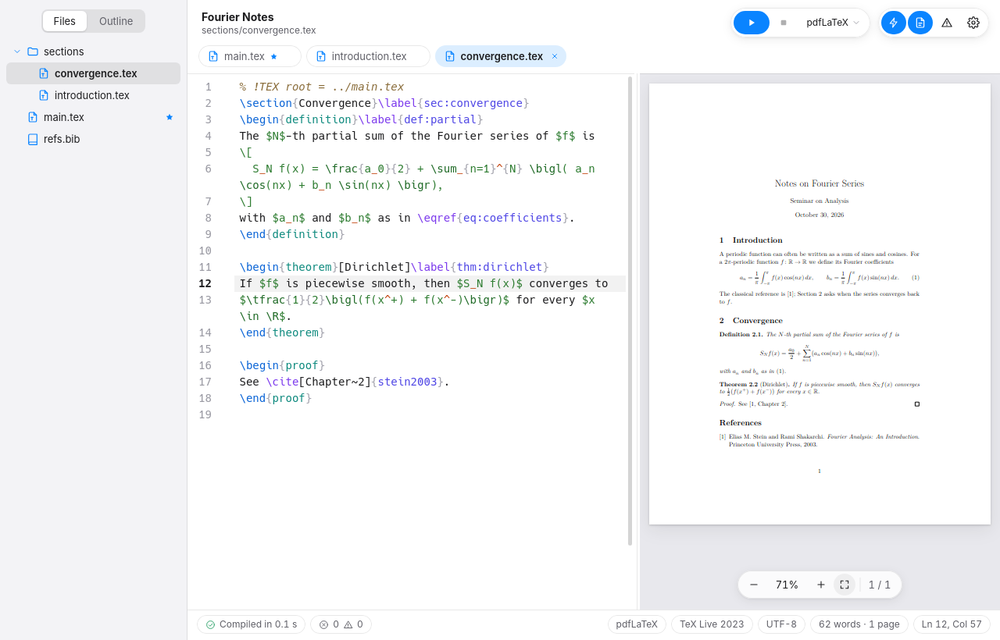
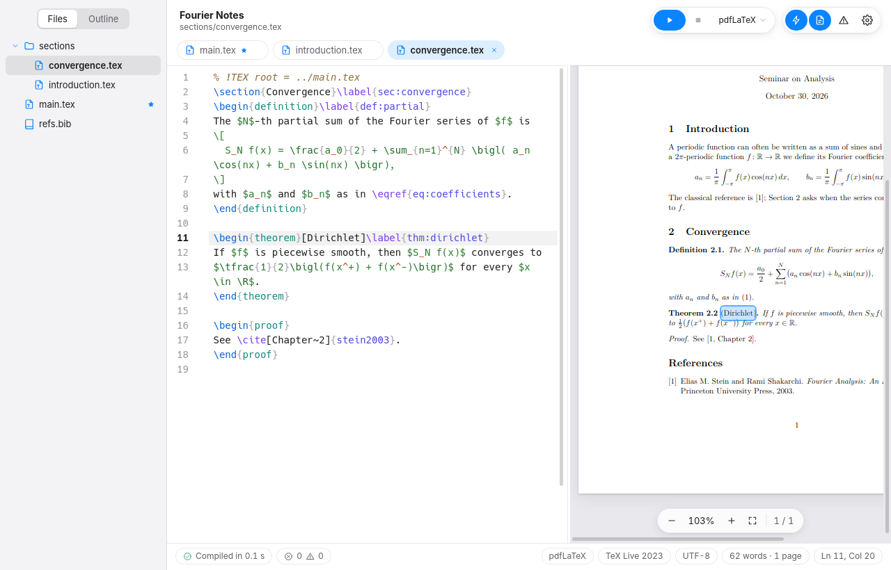
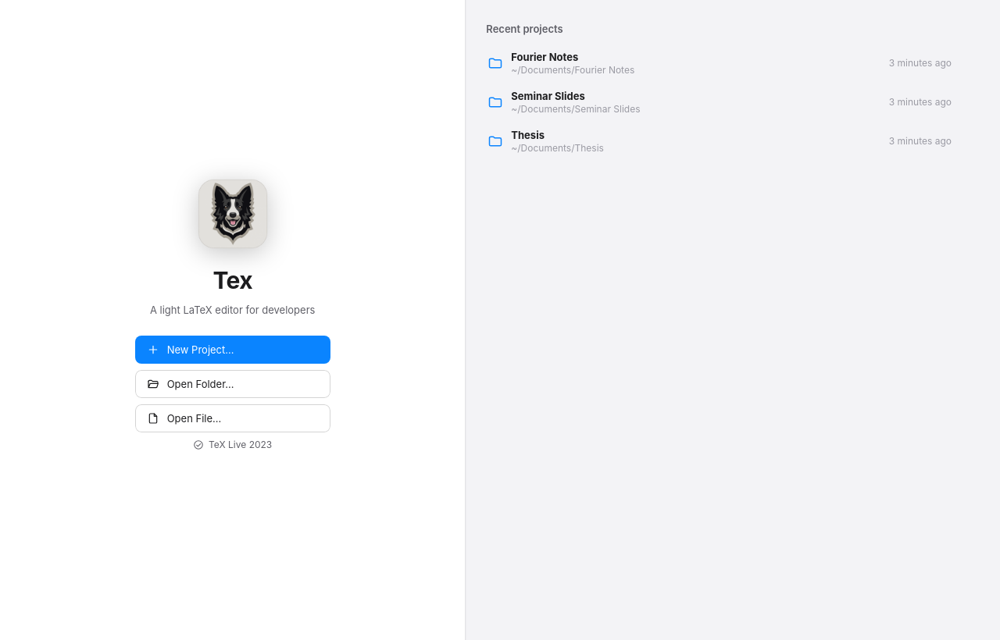

<p align="center">
  
</p>

<h1 align="center">Tex</h1>

<p align="center">
  <b>Um editor LaTeX leve, feito para desenvolvedores.</b><br>
  O PDF acompanha o texto não salvo enquanto você digita, um clique leva do PDF à palavra exata no código e de volta,
  e cada erro aparece sublinhado na linha que o causou.
</p>

<p align="center">
  <a href="https://github.com/toniesteves/tex/releases/latest"></a>
  <a href="LICENSE"></a>
  
</p>

<p align="center">
  <a href="https://github.com/toniesteves/tex/releases/latest"></a>
</p>

<p align="center">
  <a href="https://github.com/toniesteves/tex/releases">Versões</a> ·
  <a href="https://github.com/toniesteves/tex/issues">Issues</a> ·
  <a href="LICENSE">Licença</a> ·
  <a href="README.md">English</a>
</p>

<p align="center">
  
</p>

---

## Plataformas

| Plataforma | Situação | Tecnologia | Download |
|---|---|---|---|
| **Linux** | Disponível (0.1.2), testado no Linux Mint 22 | Tauri 2 (Rust + TypeScript), com o WebKitGTK do sistema | [Pacote `.deb`](https://github.com/toniesteves/tex/releases/latest) |

## Por que o Tex

A maioria dos documentos LaTeX é uma pasta: um `main.tex`, um arquivo por capítulo ou seção, figuras e um `.bib`. O Tex
foi feito para essa pasta e procura não atrapalhar:

1. **Leve.** Um pacote de 2,7 MB que usa o navegador embutido que o sistema já tem. Sem navegador próprio, sem Electron.
2. **Sua pasta continua limpa.** O TeX roda num cache privado, então nenhum `.aux`, `.log` ou `.synctex.gz` vai parar ao
   lado dos seus arquivos, e o texto que você ainda não salvou é compilado sem ser gravado no disco.
3. **Resposta rápida.** Cerca de um segundo depois de você parar de digitar, o PDF mostra a mudança e os erros aparecem
   sublinhados no editor, na linha certa do arquivo certo.

## Principais recursos

- **Pastas e navegação:** abra qualquer pasta (ou um `.tex`, que abre a pasta dele) ou comece por um modelo: Artigo,
  Tese, Apresentação (Beamer), Notas de Matemática, Lista de Exercícios ou Em branco. Árvore de arquivos com menu de
  contexto, abas, Abrir Rápido (Ctrl+P) e a estrutura do documento atravessando todos os arquivos incluídos, com os rótulos.
- **Compilação ao vivo:** `latexmk` com pdfLaTeX, XeLaTeX ou LuaLaTeX, escolhido pelo comentário `% !TEX program`, pelo
  projeto ou pelo padrão. O arquivo principal vem do `% !TEX root`, da sua escolha ou de uma detecção automática.
  Salvar (Ctrl+S) ou compilar (Ctrl+B) grava o PDF ao lado do arquivo principal.
- **Erros e avisos no lugar:** mensagens do TeX e do BibTeX sublinhadas na linha certa, mais avisos imediatos de
  referência indefinida, rótulo duplicado e citação fora da bibliografia. Painel de Problemas com filtros e o log completo.
- **SyncTeX nos dois sentidos, na palavra exata:** clique duplo numa palavra do PDF leva a ela no código; Ctrl+clique no
  código (ou Ctrl+Shift+J) destaca a palavra no PDF. O PDF recarrega sem piscar e mantém a posição.
- **Autocompletar:** comandos, ambientes (`\begin{` já escreve o `\end`), `\end{` com o ambiente aberto primeiro, rótulos
  em `\ref`, chaves em `\cite`, arquivos em `\input` e `\includegraphics`, pacotes, classes e os comandos e ambientes que
  o próprio projeto define. Dentro de matemática, os comandos de matemática vêm primeiro.
- **Apresentações Beamer (F5):** a plateia em tela cheia num monitor e, no outro, a visão do apresentador com o próximo
  slide, as notas do Beamer, cronômetro e relógio. Com um monitor só, a tecla P mostra a visão do apresentador por cima.
- **Ferramentas de escrita:** Paleta de Comandos (Ctrl+Shift+P), atalhos editáveis, modo Vim opcional, contagem de
  palavras e páginas, tema claro e escuro e interface em português e inglês (os dois seguem o sistema).

<p align="center">
  
</p>

<p align="center">
  
</p>

## Obtenha o Tex

Baixe o `.deb` da [versão mais recente](https://github.com/toniesteves/tex/releases/latest) e instale com o apt, que
também instala o `latexmk` e um TeX Live básico se faltarem:

```sh
sudo apt install ./Tex_0.1.2_amd64.deb
```

O Tex aparece no menu do sistema, em Escritório. Pelo terminal, abra uma pasta ou um arquivo:

```sh
tex-editor ~/tese
tex-editor capitulo.tex
```

O comando é `tex-editor`, não `tex`, porque `tex` é o próprio TeX (`/usr/bin/tex`, do TeX Live). Para desinstalar:
`sudo apt remove tex`.

Para biblatex com biber, instale também o `biber`. Pacotes LaTeX que faltarem vêm do apt (`texlive-latex-extra`,
`texlive-science` e outros); no Debian e no Linux Mint, o `tlmgr` não instala pacotes.

Se o `.deb` estiver numa partição que o apt não consegue ler como usuário comum (um disco NTFS, por exemplo), ele avisa
que fez o download "sem isolamento". É inofensivo; para evitar o aviso, copie o arquivo para `/tmp` antes de instalar.

### Atalhos padrão

| Ação | Atalho | Ação | Atalho |
|---|---|---|---|
| Compilar (salva tudo e grava o PDF) | Ctrl+B | Paleta de Comandos | Ctrl+Shift+P |
| Salvar / Salvar Tudo | Ctrl+S / Ctrl+Alt+S | Abrir Rápido | Ctrl+P |
| Parar a compilação | Ctrl+. | Ajustes | Ctrl+, |
| Mostrar no PDF | Ctrl+Shift+J | Localizar / Substituir | Ctrl+F / Ctrl+H |
| Próximo / anterior problema | F8 / Shift+F8 | Ir para a linha | Ctrl+G |
| Iniciar apresentação | F5 | Comentar/Descomentar | Ctrl+/ |
| Mostrar/Ocultar o PDF | Ctrl+Alt+P | Sugestões | Ctrl+Space (ou Tab) |
| Mostrar/Ocultar Problemas | Ctrl+Shift+M | Novo arquivo / Fechar aba | Ctrl+N / Ctrl+W |
| Mostrar/Ocultar a barra lateral | Ctrl+Alt+B | Abrir pasta / Novo projeto | Ctrl+O / Ctrl+Shift+N |
| Zoom do PDF | Ctrl+= / Ctrl+- / Ctrl+0 | Abas | Ctrl+Tab, Ctrl+1…9 |

Todos podem ser trocados em Ajustes › Atalhos. No modo Vim, com o foco no editor, Ctrl+B, D, E, F, H, R, U, V, W e Y
ficam com o Vim.

## Como funciona

- **Compilação no lugar.** O `latexmk` roda na própria pasta do arquivo principal, então `\input{../macros}`, figuras e
  `.bib` resolvem exatamente como no disco, mas grava tudo num cache em `~/.cache/tex-editor/`. Cada arquivo com
  alterações não salvas é copiado para o cache e trocado pelo original com `\declare@file@substitution`, um recurso do
  próprio LaTeX. Quando dois arquivos do projeto têm o mesmo nome, um pequeno despachante em TeX escolhe a versão certa
  a partir do caminho pedido.
- **Rust só onde o sistema é necessário.** A camada em Rust lê e grava arquivos, roda o `latexmk` e o `synctex` e
  observa a pasta. Todo o entendimento de LaTeX fica em TypeScript: o scanner, o índice do projeto, a leitura do log, o
  autocompletar e a sincronia por palavra.

## Desenvolvimento

Requisitos: Rust (via [rustup](https://rustup.rs)), Node.js 22+, os arquivos de desenvolvimento do WebKitGTK
(`sudo apt install libwebkit2gtk-4.1-dev build-essential`) e o TeX Live com `latexmk`.

```sh
npm install
npm run tauri dev                      # o app, com recarga automática
npm run tauri dev -- -- ~/tese         # já abrindo uma pasta
npm test                               # testes do frontend (vitest)
(cd src-tauri && cargo test)           # testes do Rust, incluindo compilações reais (pulados sem latexmk)
npm run tauri build -- --bundles deb   # pacote em src-tauri/target/release/bundle/deb/
```

Antes de gerar um pacote novo, suba a versão em `package.json`, `src-tauri/tauri.conf.json` e `src-tauri/Cargo.toml`: o
apt não atualiza um pacote para a mesma versão.

### Estrutura do repositório

```text
tex/
├── src/                  o app (TypeScript, sem framework de interface)
│   ├── latex/            scanner, índice do projeto, leitura de log, catálogo do autocompletar, sincronia por palavra, modelos
│   ├── editor/           editor CodeMirror 6 e realce de LaTeX
│   ├── pdf/              visualizador de PDF (pdf.js)
│   ├── present/          apresentação: plateia e visão do apresentador
│   ├── ui/               boas-vindas, barra lateral, problemas, paleta, ajustes, novo projeto
│   ├── project.ts        um projeto aberto
│   └── app.ts            comandos e janelas
├── src-tauri/            arquivos, compilação, SyncTeX e observação da pasta (Rust), ícones, configuração do pacote
├── docs/assets/          ícone e capturas de tela deste README
└── README.md  README.pt-BR.md  LICENSE
```

## Limitações conhecidas

- Só Linux. Testado no Linux Mint 22.3 (X11, Cinnamon) com o TeX Live 2023.
- A apresentação com dois monitores ainda não foi testada num segundo monitor de verdade; com um monitor, foi.
- Alterações não salvas em arquivos `.bib` só entram na compilação depois de salvar (o BibTeX lê os arquivos direto do disco).
- Um arquivo não salvo cujo nome tem espaços ou caracteres especiais do TeX compila a versão salva.
- Sem verificação ortográfica.

## Como contribuir

Relatos de bugs, ideias e pull requests são bem-vindos, **em português ou em inglês**, pelas
[issues](https://github.com/toniesteves/tex/issues) e pull requests deste repositório.

## Licença

O Tex é distribuído sob a [Licença MIT](LICENSE). Copyright © 2026 Toni Esteves.
